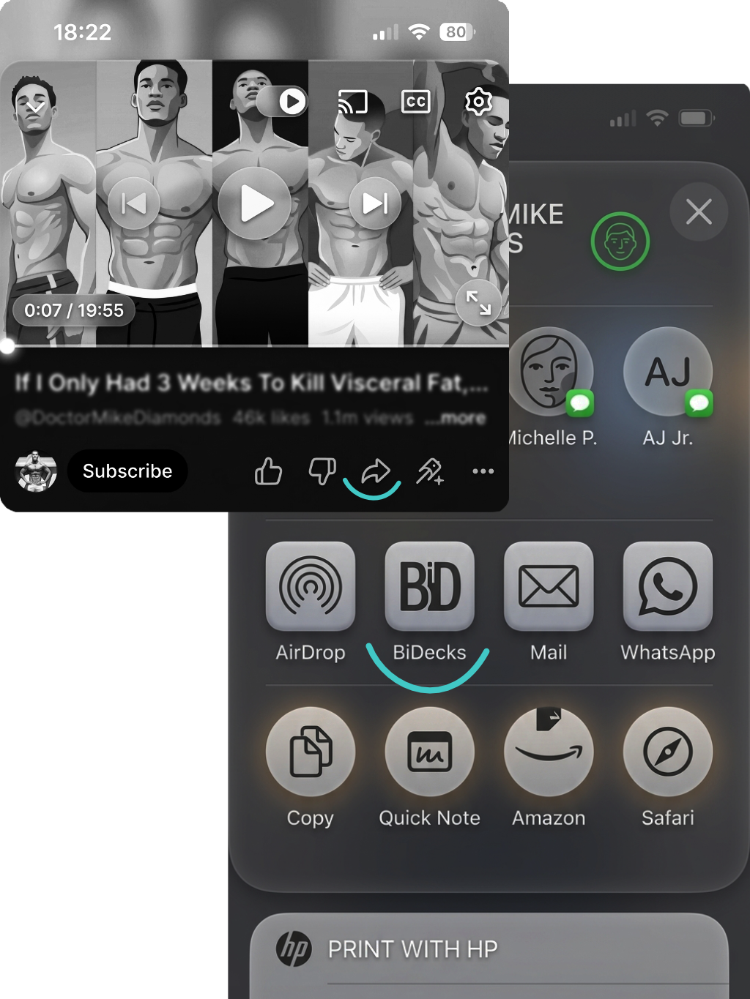
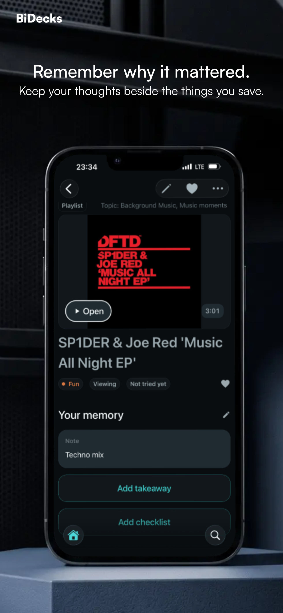
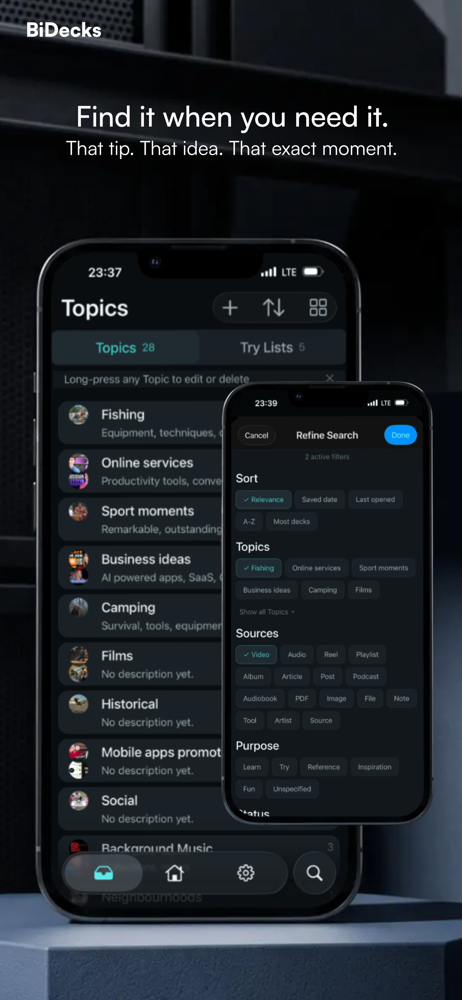
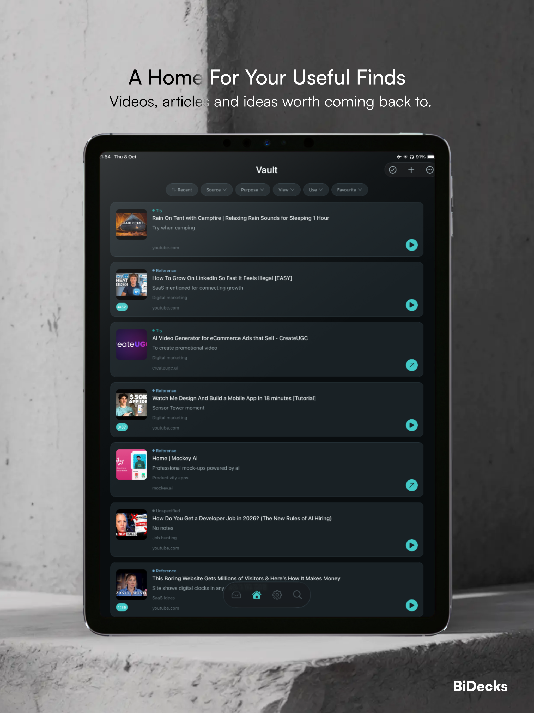
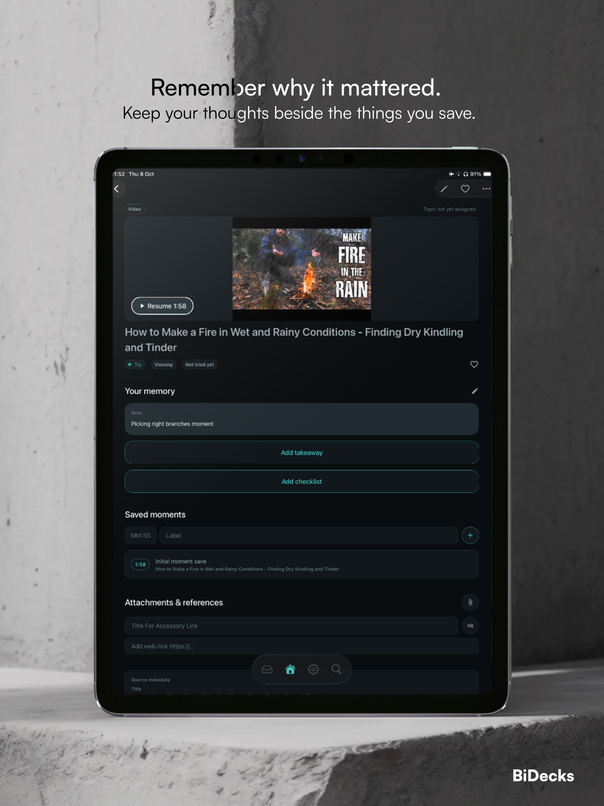

# BiDecks

**A local-first iOS and Android application for collecting, annotating, and retrieving online learning material.**

> This repository contains the [BiDecks website](https://bidecks.com). The mobile application's source code is maintained in a separate, private repository. The overview below describes the mobile product and its engineering.

## What the app does

BiDecks saves references to online material, including videos, articles, podcasts, and posts, together with the user's own context. Each saved item, called a **Deck**, combines a source link and available metadata with optional notes, a key takeaway, checklists, attachments, and timestamped moments. Users can organize Decks by subject or intended activity, track viewing and practical-use states separately, and retrieve material through search and filters. The working library, or **Vault**, is stored locally; original media remains with its provider rather than being downloaded into the app.

## Screenshots

<!-- Add the five images at these paths, or replace the paths and captions. -->

### Phone

| Capture a source | Annotate a Deck | Search and filter |
| :---: | :---: | :---: |
|  |  |  |

### Tablet

| Browse the Vault | Work with saved material |
| :---: | :---: |
|  |  |

## Target users

BiDecks serves self-directed learners, developers, and practical hobbyists who collect material across multiple platforms and need to retrieve and apply it later.

## Product positioning

BiDecks sits between bookmark managers, read-it-later applications, and general-purpose personal knowledge-management systems. The product decision is to keep capture possible with only a link, while allowing each save to accumulate personal context over time. Topics provide subject-based organization; independent Try Lists group material around an activity. Retrieval combines source information with the user's own wording, rather than relying solely on titles or folders. The scope is deliberately narrower than a research notebook or full content-ingestion platform: it does not depend on importing complete articles, transcripts, or media, and it does not require users to maintain a linked-note system.

## Mobile app technology

- **TypeScript, React, and React Native** - shared application code for iOS and Android.
- **Expo and Expo Router** - native integration, file-based routing, stacks, and modal flows.
- **SQLite via expo-sqlite** - on-device relational storage and offline access to saved context.
- **Drizzle ORM and Drizzle Kit** - typed database access, schema definitions, and migrations.
- **SQLite FTS5** - full-text indexes, BM25 relevance ranking, stemming, prefix matching, and trigram-based close matching.
- **Zustand** - client state, including the active search session.
- **Node.js, Fastify, and Zod** - metadata-service endpoints and request validation.
- **React Native Reanimated and Gesture Handler** - animations and gesture-driven interactions.
- **Expo FileSystem, Sharing, and document/image pickers; react-native-zip-archive** - attachments, cross-app entry points, and archive-based transfer.
- **i18next and react-i18next** - interface localization.

## Main features by workflow

### 1. Capture

- Save links through the native sharing interface or paste/type them inside the app.
- Preview available source metadata before saving.
- Save immediately or add a custom title, note, purpose, Topic, or Try List.
- For recognized sources already saved, add context to the existing Deck or deliberately create a separate save.
- Keep a basic reference even when metadata retrieval is unavailable.

### 2. Annotate and enrich

- Maintain personal notes, a key takeaway, and checklists.
- Attach locally retained images and files, plus supplementary web links.
- Add and edit labeled timestamps for supported media sources.
- Keep the user's custom title separate from the original source title.

### 3. Organize

- Assign a Deck to multiple Topics or Try Lists without duplicating it.
- Use Topics for subject-based browsing and Try Lists for activity-based groupings.
- Track viewing progress separately from whether material has been tried or learned.
- Record list-specific action states and result notes within Try Lists.
- Favourite or archive Decks and apply supported bulk organization actions.

### 4. Find and use

- Search Deck titles, source titles and authors, notes, takeaways, source descriptions, saved-moment labels, and Topic names.
- Search Topics by their names and descriptions.
- Narrow Deck results by Topic, source type, purpose, viewing state, practical-use state, favourites, or the presence of timestamps; optionally include archived items.
- Sort results and inspect highlighted matching text.
- View typo-tolerant suggestions in a separate **Close matches** section.
- Open original sources in their app or browser, including timestamped handoff where supported.
- Consult saved context and available local attachments offline; accessing original online material remains provider-dependent.

### 5. Transfer and preserve

- Export selected Decks, their context, and available attachments as transferable packages.
- Import received Deck packages into the local library.
- Export the complete Vault and restore it from an archive.
- Review confirmation before a full-Vault restore replaces the current library; this is distinct from importing selected Decks.

## Engineering challenges and implementation

### 1. Normalizing metadata from heterogeneous sources

Different providers expose different link formats, identifiers, fields, and retrieval methods. An ordered adapter registry selects provider-specific handling, with a generic web adapter as the final fallback. Adapters return a shared extraction model; the persistence pipeline selects field candidates by confidence and retains extraction provenance. Source identity is separate from the incoming link, supporting recognition across alternate URL forms. A missing preview does not prevent saving the reference.

### 2. Combining full-text retrieval, filters, and approximate matches

A useful search result may match a personal note, source description, Topic, or saved moment rather than the Deck title. Separate Deck and Topic FTS5 indexes consolidate the relevant text, with database triggers maintaining indexed content. Queries combine BM25 ranking with relational filters, while prefix matching supports suggestions during typing. Submitted searches also request a bounded trigram-based close-match search. Approximate hits are deduplicated against the returned exact results and displayed separately. Request identifiers prevent older responses from replacing newer search state.

### 3. Supporting multiple organizational contexts without copying data

The same source may be relevant to several subjects and activities, while its outcome can differ between activities. Many-to-many relationships connect Decks to Topics and Try Lists. Source information and personal context remain attached to one Deck; list-specific action states and result notes belong to the Try List membership. This separates shared reference data from contextual progress and avoids divergent copies.

### 4. Restoring a local database and its files consistently

A Vault backup includes both relational data and filesystem assets, so replacing the database alone is insufficient. Restore preparation validates the archive in staging, checks compatibility and database integrity, and migrates supported older backups before touching the live library. The commit process retains rollback copies, journals its progress, swaps assets, replaces the database, and validates the result. Rollback and startup recovery address failed or interrupted restores.

## App links

<!-- Replace both placeholder URLs with the published store listings. -->

[App Store][app-store] | [Google Play][google-play]

[app-store]: https://apps.apple.com/app/idREPLACE_ME
[google-play]: https://play.google.com/store/apps/details?id=REPLACE_ME

